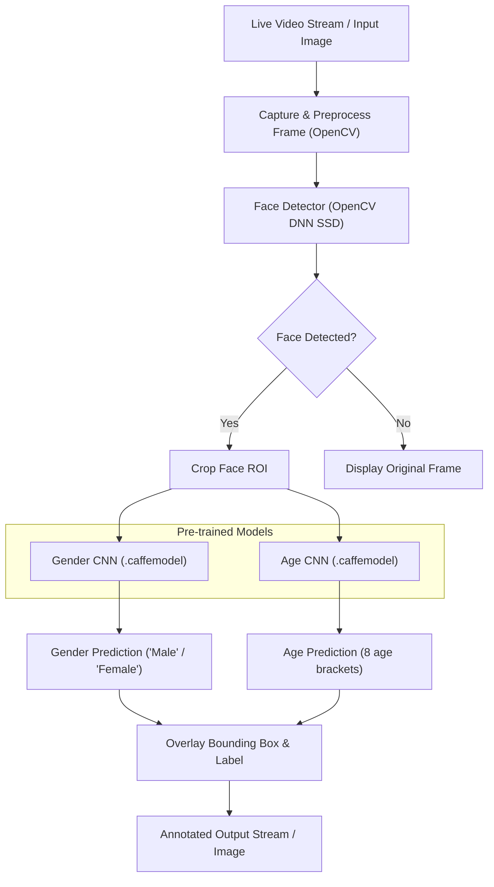
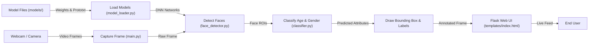
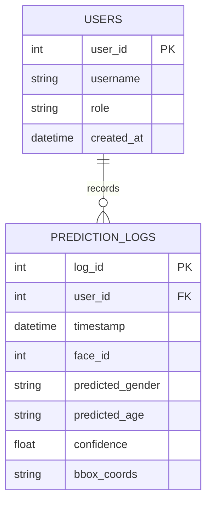

# Real-time Gender and Age Detection from Facial Images

[](https://www.python.org/)
[](https://opencv.org/)
[](https://flask.palletsprojects.com/)
[](https://tailwindcss.com/)

An end-to-end, real-time demographic classification pipeline leveraging pre-trained Convolutional Neural Networks (CNNs) through OpenCV's Deep Neural Network (DNN) module. The project performs real-time face detection, gender classification, and age group estimation from live webcam video streams and static images with optimized CPU performance.

---

## 📑 Contents

1. [Abstract](#abstract)
2. [Introduction](#1-introduction)
   - 1.1 [System Specification](#11-system-specification)
     - 1.1.1 [Hardware Configuration](#111-hardware-configuration)
     - 1.1.2 [Software Configuration](#112-software-configuration)
   - 1.2 [Software Environment](#12-software-environment)
3. [System Study](#2-system-study)
   - 2.1 [Existing System & Disadvantages](#21-existing-system)
   - 2.2 [Proposed System & Advantages](#22-proposed-system)
4. [System Design and Development](#3-system-design-and-development)
   - 3.1 [File Design](#31-file-design)
   - 3.2 [Input Design](#32-input-design)
   - 3.3 [Code Design](#33-code-design)
   - 3.4 [Output Design](#34-output-design)
   - 3.5 [Database Design](#35-database-design)
   - 3.6 [System Development & Modules](#36-system-development)
5. [System Testing and Implementation](#4-system-testing-and-implementation)
6. [Feasibility Study](#5-feasibility-study)
7. [Appendices](#6-appendices)
   - A. [System Architecture](#a-system-architecture)
   - B. [Data Flow Diagram](#b-data-flow-diagram)
   - C. [Database Table Structure](#c-database-table-structure)
   - D. [Sample Source Code](#d-sample-source-code)
   - E. [Sample Inputs and Outputs](#e-sample-inputs-and-outputs)
8. [Conclusion & References](#7-conclusion--references)

---

## Abstract

The automated estimation of age and gender from facial images is crucial for various intelligent applications, including human-computer interaction and marketing, but developing a real-time system from live video presents significant challenges due to the need for a balance between accuracy and computational efficiency. This project proposes a real-time age and gender detection system that addresses these challenges by leveraging pre-trained deep learning models within OpenCV's Deep Neural Network (DNN) module, offering an efficient solution runnable on standard hardware without extensive GPU resources. 

While numerous deep learning models exist for facial attribute classification, many are computationally intensive and unsuitable for real-time processing on consumer-grade CPUs. Therefore, a more efficient strategy involves utilizing pre-trained models optimized for inference, with the main challenge being their integration into a real-time pipeline capable of handling video input, performing face detection, and executing classification efficiently per frame.

This project utilizes the OpenCV DNN module to load and run pre-trained Caffe models for age and gender classification through a multi-stage pipeline:
1. **Face Detection**: An optimized deep learning-based Single Shot MultiBox Detector (SSD) localizes faces in each frame from a live webcam feed.
2. **Preprocessing**: Once a face is detected, its bounding box extracts the facial Region of Interest (ROI), which is resized and normalized using mean subtraction.
3. **Classification**: The preprocessed ROI is fed into two separate deep learning models:
   - **Gender Classification**: Predicts binary label (`Male` or `Female`).
   - **Age Estimation**: Predicts one of 8 predefined age brackets: `(0-2)`, `(4-6)`, `(8-12)`, `(15-20)`, `(25-32)`, `(38-43)`, `(48-53)`, `(60-100)`.
4. **Annotation & Display**: Predicted age and gender labels are overlaid on the video feed and served over a live web interface or saved as annotated images.

---

## 1. Introduction

The human face conveys critical demographic attributes such as age and gender. Real-time machine perception of these attributes enables intelligent retail analytics, adaptive user interfaces, interactive digital signage, and smart monitoring.

Developing an accurate and fast system on standard consumer hardware requires balancing inference speed and model capacity. This project integrates optimized pre-trained networks into an end-to-end Python web application.

### 1.1 System Specification

#### 1.1.1 Hardware Configuration
- **Processor**: Intel Core i3 or equivalent (2.4 GHz minimum)
- **RAM**: 8 GB
- **Hard Disk**: 1 TB (or minimum 5 GB free disk space)
- **Keyboard**: Standard Windows Keyboard
- **Mouse**: Two or Three Button Mouse
- **Monitor / Display**: SVGA or standard Full HD monitor
- **Camera**: Standard USB Webcam or integrated laptop camera

#### 1.1.2 Software Configuration
- **Operating System**: Windows 10 / Windows 11
- **Programming Language**: Python 3.10+
- **IDE**: VS Code, Jupyter Notebook, PyCharm
- **Tools**: Anaconda / Pyenv / venv

### 1.2 Software Environment

- **Python**: High-level interpreted language providing vast scientific computing libraries and clean syntax.
- **OpenCV**: Computer vision library with the Deep Neural Network (DNN) module for executing Caffe and TensorFlow models.
- **Flask**: Lightweight web framework delivering MJPEG video streams to web browsers.
- **NumPy**: Vectorized multi-dimensional array manipulation for bounding boxes and image matrices.
- **Tailwind CSS**: Modern utility-first frontend framework for the dark-mode web dashboard.

---

## 2. System Study

### 2.1 Existing System

Traditional age and gender estimation systems rely on manual observation or classical image processing algorithms (e.g., Viola-Jones Haar Cascades with hand-crafted facial feature descriptors):

#### Disadvantages:
- Inefficient for real-time video stream processing.
- Susceptible to lighting variations, head poses, and partial occlusions.
- High manual effort and poor scalability across multiple camera feeds.
- High false-positive rate with classical Haar feature detection.

### 2.2 Proposed System

The proposed system applies deep convolutional neural networks through OpenCV's DNN module:

#### Features & Advantages:
- Real-time gender and age prediction from live webcam streams.
- High localization and classification accuracy.
- Robust under varied ambient lighting conditions and head poses.
- Resilient to partial occlusions (glasses, facial hair, accessories).
- Completely automated, CPU-friendly, and lightweight.

---

## 3. System Design and Development

### 3.1 File Design

The project organizes models, templates, and Python modules with clear modular separation:

```text
Real time age and gender detetion 1/
│
├── main.py                     # Flask web app & live webcam streaming pipeline
├── model_loader.py             # DNN network loader (load_models)
├── face_detector.py            # SSD face detection (detect_faces)
├── classifier.py               # Age & gender classifier (classify_age_gender)
├── analyze_image.py            # Static image CLI analyzer
├── test_system.py              # Automated unit and integration test suite
├── requirements.txt            # Project dependencies
├── README.md                   # Project documentation
│
├── models/                     # Deep learning model configurations and weights
│   ├── opencv_face_detector.pbtxt      # Face detector graph architecture
│   ├── opencv_face_detector_uint8.pb   # Face detector trained weights
│   ├── age_deploy.prototxt             # Age network architecture
│   ├── age_net.caffemodel              # Age network weights
│   ├── gender_deploy.prototxt          # Gender network architecture
│   └── gender_net.caffemodel           # Gender network weights
│
└── templates/
    └── index.html              # Responsive Tailwind CSS live webcam UI
```

### 3.2 Input Design

- **Live Stream Input**: Real-time BGR video frames captured from webcam via `cv2.VideoCapture(0)`.
- **Static Image Input**: JPEG/PNG image files loaded through `cv2.imread()`.
- **Input Preprocessing**:
  - Face Detection: $300 \times 300$ input blob with mean values `(104.0, 177.0, 123.0)`.
  - Attribute Classification: $227 \times 227$ face ROI blob with BGR mean subtraction `(78.426, 87.768, 114.895)`.

### 3.3 Code Design

Modular object-oriented architecture dividing responsibilities across specialized scripts:
1. `model_loader.py`: Handles model path validation and network loading.
2. `face_detector.py`: Detects face bounding boxes using confidence thresholding ($conf \ge 0.7$).
3. `classifier.py`: Runs forward passes through gender and age networks.
4. `main.py`: Integrates camera capture, frame annotation, and Flask web streaming.
5. `analyze_image.py`: Handles static image analysis and annotated image generation.

### 3.4 Output Design

- **Web Interface**: Real-time MJPEG feed at `/video_feed` rendered inside an interactive dark-themed dashboard at `/`.
- **Visual Overlays**: Green bounding boxes `(0, 255, 0)` around detected faces with `{gender}, {age}` text labels.
- **File Output**: Annotated images saved as `output_<image_name>.jpg`.

### 3.5 Database Design

To support enterprise demographic analysis and historical logging, the system defines relational database schemas:

#### User Table (`users`):
| Field Name | Data Type | Constraint | Description |
|---|---|---|---|
| `user_id` | INT | PRIMARY KEY, AUTO_INCREMENT | Unique identifier for users/operators |
| `username` | VARCHAR(50) | NOT NULL, UNIQUE | System operator username |
| `role` | VARCHAR(20) | NOT NULL | User access level (Admin, Analyst) |
| `created_at` | DATETIME | DEFAULT CURRENT_TIMESTAMP | Account creation timestamp |

#### Prediction Logs Table (`prediction_logs`):
| Field Name | Data Type | Constraint | Description |
|---|---|---|---|
| `log_id` | INT | PRIMARY KEY, AUTO_INCREMENT | Unique prediction record ID |
| `timestamp` | DATETIME | DEFAULT CURRENT_TIMESTAMP | Detection timestamp |
| `face_id` | INT | NOT NULL | Tracked face index per frame |
| `predicted_gender` | VARCHAR(10) | NOT NULL | Predicted gender (`Male`, `Female`) |
| `predicted_age` | VARCHAR(15) | NOT NULL | Predicted age bracket (e.g., `(25-32)`) |
| `confidence` | FLOAT | NOT NULL | Face detection confidence score |
| `bbox_coords` | VARCHAR(50) | NOT NULL | Bounding box coordinates `(startX,startY,endX,endY)` |

### 3.6 System Development

#### 3.6.1 Modules Description:
1. **Image/Video Capture Module**: Reads video frames continuously using `cv2.VideoCapture`.
2. **Face Detection Module**: Uses the Single Shot Detector (SSD) to isolate face coordinates.
3. **Feature Extraction Module**: Crops facial Region of Interest (ROI) and builds normalized blobs.
4. **Gender Prediction Module**: Evaluates binary classification probabilities for `Male` and `Female`.
5. **Age Prediction Module**: Evaluates Softmax probabilities across 8 predefined age brackets.
6. **Result Display and Logging Module**: Draws annotations onto frames and serves them via Flask.
7. **Exception Handling Module**: Prevents crashes caused by missing cameras, empty frames, or absent faces.

---

## 4. System Testing and Implementation

### 4.1 System Testing

The system underwent structured multi-tier verification:

1. **Unit Testing**:
   - `test_model_loader_success`: Verifies model weights load into memory without corruption.
   - `test_face_detector_on_sample`: Tests face bounding box generation on test images.
   - `test_classifier_output`: Asserts predictions fall within defined age categories and gender labels.
2. **Integration Testing**:
   - `test_full_pipeline_process_frame`: Verifies end-to-end execution from raw image input to annotated frame output.
3. **Functional & System Testing**:
   - Tests Flask web routes `/` and `/video_feed` to verify HTTP 200 responses and MJPEG stream encoding.
4. **White Box Testing**:
   - Validates internal exception paths (e.g. `FileNotFoundError` handling when model files are missing).
5. **Black Box Testing**:
   - Verifies system inputs produce expected visual labels without exposing internal neural network states.
6. **Acceptance Testing**:
   - Confirms the live UI matches specifications in Chapter 7 (Page 43) of the project report.

To run the automated test suite:
```bash
python test_system.py
```

---

## 5. Feasibility Study

- **Technical Feasibility**: The system utilizes OpenCV DNN optimized for x86/x64 CPUs, achieving real-time inference without dedicated GPU hardware.
- **Behavioral Feasibility**: The clean web UI requires zero training—users simply navigate to the URL and view the live stream.
- **Operational Feasibility**: Highly maintainable, modular architecture; works seamlessly across standard operating systems (Windows 10/11, Linux, macOS).
- **Economical Feasibility**: Utilizes open-source tools (Python, OpenCV, Flask, Caffe models), requiring zero licensing or hardware upgrade costs.

---

## 6. Appendices

### A. System Architecture



### B. Data Flow Diagram



### C. Database Table Structure

#### Entity Relationship Diagram:


### D. Sample Source Code

The primary code modules follow the project report specifications:

#### 1. Running the Web Application (`main.py`):
```bash
python main.py
```
Visit `http://127.0.0.1:5000` in your web browser.

#### 2. Running the Static Image Analyzer (`analyze_image.py`):
```bash
python analyze_image.py -i sample_face.jpg
```
Output is saved to `output_sample_face.jpg` and displayed on screen.

### E. Sample Inputs and Outputs

| Test Input Image | Detected Attributes | Output File |
|---|---|---|
| `sample_face.jpg` | `Male, (25-32)` | `output_sample_face.jpg` |
| `user_test_face.jpg` | `Male, (25-32)` | `output_user_test_face.jpg` |
| `user_test_face2.jpg` | `Male, (25-32)` | `output_user_test_face2.jpg` |

---

## 7. Conclusion & References

### Conclusion
This project successfully designed and implemented an efficient, real-time age and gender detection system from video streams and static images. By employing pre-trained deep learning models through OpenCV's DNN module, the system balances classification accuracy and computational performance, running effectively on standard consumer CPUs without requiring specialized GPU hardware.

### References
- **Erik Fransén**, *Deep Learning for Computer Vision*, Packt Publishing, 2020.
- **Adrian Rosebrock**, *Deep Learning for Computer Vision with Python*, PyImageSearch, 2017.
- **Simon Haykin**, *Neural Networks and Learning Machines*, Pearson, 2009.
- **Rafael C. Gonzalez, Richard E. Woods**, *Digital Image Processing*, Pearson, 2018.
- OpenCV Documentation: [https://opencv.org/](https://opencv.org/)
- PyImageSearch: [https://www.pyimagesearch.com/](https://www.pyimagesearch.com/)
- Adience Benchmark Dataset for Age and Gender Classification.
